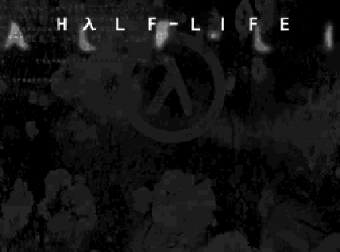
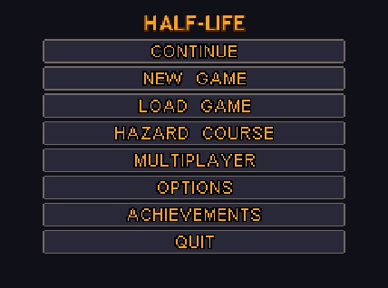
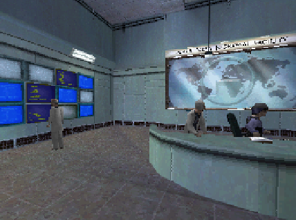
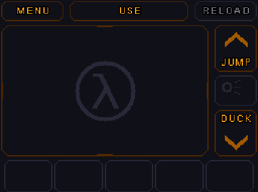
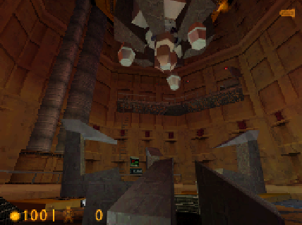

# Half-Life for Nintendo DS

Half-Life running natively on the DS and DSi: the original campaign at DS scale, with local wireless multiplayer and Download Play.

**No game files are in the repository or the ROM; the difficulty table's numbers are built in for now.** You bring your own copy of Half-Life, and a converter turns it into the files the console reads from its SD card.

This is an unofficial fan project, not affiliated with or endorsed by Valve.

| Top screen | Touch screen |
|:--:|:--:|
|  |  |
|  |  |
|  | |

Screenshots are real captures of the port, showing art from the owner's copy of the game.

## Features

- The game's maps, with their lighting, textures, water and decals, drawn by the DS's 3D hardware
- Player movement that plays like the original: walking, climbing, swimming, ladders
- Weapons, monsters and people, with the game's AI, scripted scenes, doors, lifts, trains and breakables
- Three difficulties, the Hazard Course, and Half-Life: Uplink if your copy has it
- Autosave, quick save and save slots
- Achievements
- Music and sound, with DSi-only extras where the extra memory allows
- Multiplayer over local wireless, on the game's own maps
- Download Play: consoles with no card can join a game hosted by one that has it
- Touch screen controls, for either hand, with two button layouts

More detail, and what isn't done yet, is in [docs/TECHNICAL.md](docs/TECHNICAL.md).

## Supported consoles

One ROM covers all of them.

| Console | Single player | Multiplayer and Download Play |
|---|---|---|
| DSi, in DSi mode | Tested on hardware | Tested on hardware |
| 3DS, in DSi mode | Tested on hardware | Tested on hardware |
| DSi or 3DS, in DS mode | Tested on hardware | Tested on hardware |
| Original DS and DS Lite | Same ROM, in DS mode; not yet confirmed on hardware | Not yet confirmed on hardware |

DSi mode has more memory, so it gets richer content than DS mode.

## Quick start

1. **Get the release.** Download the ROM zip and the converter for your system from the [Releases](https://github.com/Warioware64/Half-Life-NDS-Port/releases) page. `SHA256SUMS.txt` lists each file's checksum.
2. **Run the converter on your own Half-Life copy.** Open the installer, which finds your game and your SD card, or use the command line:

   ```sh
   hlds-convert cook-all <path to>/Half-Life/valve -o <SD card root>
   ```

   Everything goes to `<card>/_nds/hl_nds/data/`. On macOS, right-click the app and choose Open the first time, because it isn't signed by a developer account.
3. **Copy the ROM to the SD card** and start it from your console's homebrew loader.

Use a converter and a ROM from the same release. The title screen shows the version at the bottom, and warns you if the card's data came from a different one.

## Controls

Choose between two layouts in OPTIONS > CONTROLS, which also explains each button.

| | CLASSIC | MODERN |
|---|---|---|
| Stylus drag | Look | Look |
| D-pad | Move | Move |
| A B X Y | Move, like the D-pad | A jump, B reload, X and Y change weapon |
| L | Fire | Fire |
| R | Second trigger | Second trigger |
| R + D-pad down or up | | Crouch and stay crouched, or stand |
| One tap on the pad | | USE |
| Two quick taps | Jump | Jump |

With either layout:

- Hold WALK on the touch screen to walk (Half-Life runs by default), or set it to toggle in OPTIONS > CONTROLS. The same page can make the jump button walk instead; two quick taps still jump.
- Touch a weapon's slot to take it, or to reload the one in your hand.
- Touch RELOAD, JUMP, DUCK or USE for what they say.
- Start, or MENU on the touch screen, opens the pause menu.
- Select, or the lamp on the touch screen, turns on the suit's lamp.

**Stylus hand: left** mirrors the touch screen and swaps the buttons over.

## Multiplayer

On the title screen, choose MULTIPLAYER, then HOST GAME on one console and JOIN GAME on the others. The host presses START when everyone is in.

Each console needs the ROM and a card with the game converted, or it can get the game from the host by Download Play.

Multiplayer has been tested on Nintendo DSi and Nintendo 3DS, and also through Download Play in both DS mode and DSi mode.

## Building from source

The container has everything, pinned to exact versions in [docker/](docker/). Only [Docker](https://docs.docker.com/get-docker/) is needed:

```sh
git clone https://github.com/Warioware64/Half-Life-NDS-Port.git
cd Half-Life-NDS-Port
./docker.sh ./make.sh                   # Linux, macOS
docker compose run --rm dev ./make.sh   # Windows PowerShell, or anywhere
```

This builds `half-life-nds-port.nds`. To build the converter and run its tests:

```sh
./docker.sh cmake -S tools/hlds-convert -B build/convert -DHLDS_BUILD_GUI=OFF
./docker.sh cmake --build build/convert -j4
./docker.sh ctest --test-dir build/convert
```

Building without Docker, the DSP toolchain, and the converter's window are all covered in [CONTRIBUTING.md](CONTRIBUTING.md).

## Credits

- **Warioware64:** the port
- **NewGBAXL:** streaming textures, 60 fps character animation, save versioning
- **Teiwazik:** the first CI work
- [BlocksDS](https://blocksds.skylyrac.net/) and the [Wonderful Toolchain](https://wonderful.asie.pl/): the SDK and compilers
- [Nitro Engine](https://github.com/AntonioND/nitro-engine) by Antonio Niño Díaz, through our [Nitro Engine Advanced fork](https://github.com/Warioware64/nitro-engine)
- [dswifi](https://github.com/blocksds/dswifi), through our [fork](https://github.com/Warioware64/dswifi) with Download Play
- [teak-llvm](https://github.com/Gericom/teak-llvm) by Gericom and [libteak](https://github.com/blocksds/libteak), through our forks
- [ptexconv](https://github.com/Garhoogin/ptexconv) by Garhoogin, [meshoptimizer](https://github.com/zeux/meshoptimizer) by Arseny Kapoulkine, [minimp3](https://github.com/lieff/minimp3), [yas](https://github.com/niXman/yas), [Qt](https://www.qt.io/) and [ArchitectDS](https://github.com/AntonioND/architectds)

Half-Life is a trademark of Valve Corporation. The port's game rules and monster behaviour are adapted from the Half-Life SDK, and parts of its engine code follow the structure of Xash3D FWGS.

## Licence

Licence under review. The game code is adapted from the Half-Life SDK and distributed under Valve's [Half-Life 1 SDK licence](LICENSE-HALF-LIFE-SDK) (free, non-commercial). Parts of the engine code are adapted from Xash3D FWGS (GPL-3.0-or-later). The rest is by the authors. The final licence, and rewrites of the adapted parts, will come in a later version.

Each third-party component's licence is in [THIRD_PARTY_LICENSES](THIRD_PARTY_LICENSES).

## Use of AI

This project was developed with the help of AI coding assistants. Every change is reviewed and tested by the author.
